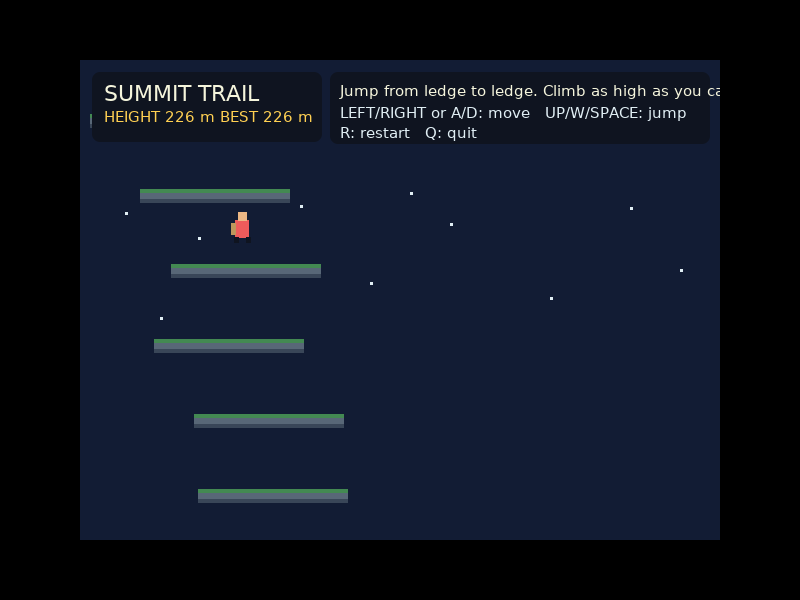

# Summit Trail — Ak hiking game

A small 2D, retro/pixel-style climbing game written in **Ak**. The mountain never ends: climb ledge to ledge, manage stamina, rest when needed, and see how high you can get. Your height and best height are shown in the HUD.




## Requirements

- Linux (x86-64) with an X11 display or XWayland
- [Ak](https://github.com/notyourbusinessss/AI-codinglanguage-) 0.6.22 or newer (`ak --version`)

Ak's X11 and canvas libraries are bundled in `lib/` (copied from Ak 0.6.22), so nothing else is needed. From this folder run:

```sh
ak game.aklang
```

## Controls

- **Arrow keys** or **WASD** — move
- **Space** — rest and recover stamina
- **R** — restart
- **Q** or **Esc** — quit

## Notes

Ledges are generated as you climb, and neighbouring ledges always overlap, so there is always a way up. This is a compact starter game, intended to be easy to extend. The graphics use Ak's native X11 canvas API, not a browser or JavaScript game engine.
