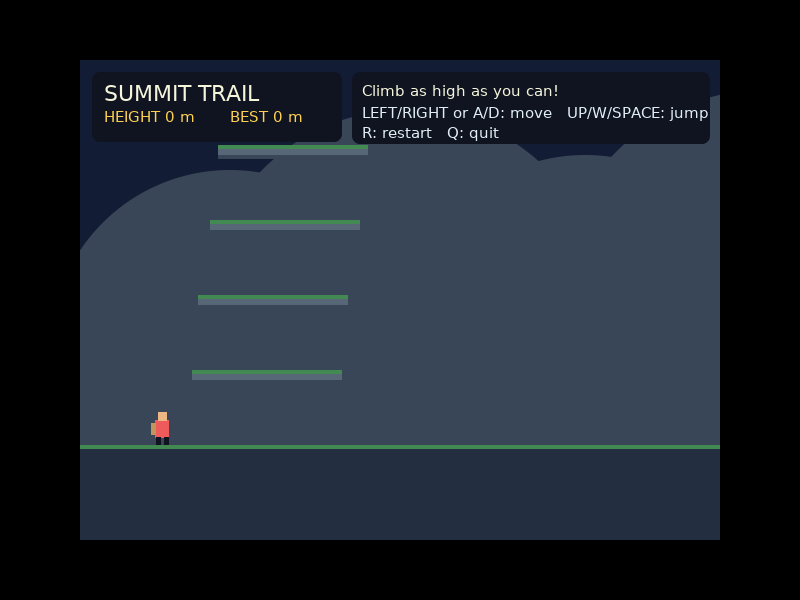
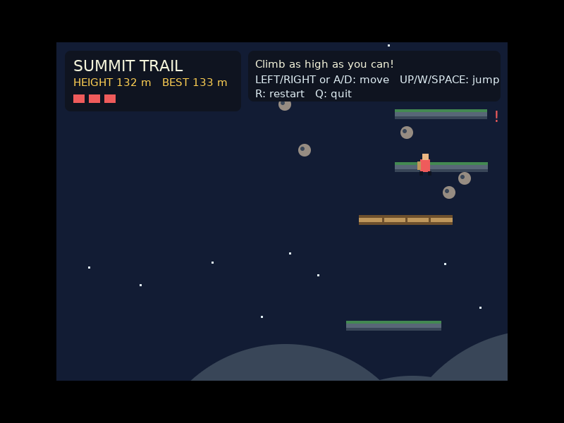

# Summit Trail — Ak hiking game

A small 2D, retro/pixel-style climbing game written in **Ak**. The mountain never ends: jump from ledge to ledge and see how high you can get. Your height and best height are shown in the HUD.




## Requirements

- Linux (x86-64) with an X11 display or XWayland
- [Ak](https://github.com/notyourbusinessss/AI-codinglanguage-) 0.6.22 or newer (`ak --version`)

Ak's X11 and canvas libraries are bundled in `lib/` (copied from Ak 0.6.22), so nothing else is needed. From this folder run:

```sh
ak game.aklang
```

## Controls

- **Left / Right** or **A / D**: move
- **Up**, **W** or **Space**: jump (hold it to keep hopping)
- **R**: restart (after falling off the bottom of the screen)
- **Q** or **Esc**: quit

Jump from ledge to ledge. Fall below the screen and it's game over; your goal is the highest climb.

## Hazards

The higher you climb, the harder it gets (the ledges also get narrower):

- **Crumbling ledges** (brown, cracked) break about half a second after you land.
- **Moving ledges** (icy top) slide sideways and carry you along.
- **Falling rocks** drop from above; a red `!` at the top of the screen warns you where. You have 3 lives (red squares in the HUD) and are briefly invulnerable after a hit.
- **Wind gusts** push you sideways, mostly while you are in the air.
- Falling off the bottom of the screen ends the run.

## Code layout

```text
game.aklang       window, main loop
src/config.aklang   constants and shared state
src/world.aklang    endless ledge generation
src/hazards.aklang  rocks and wind
src/player.aklang   input, jumping, landing
src/render.aklang   drawing and HUD
lib/                Ak's X11 and canvas libraries (bundled)
```

## Notes

Ledges are generated as you climb, and neighbouring ledges always overlap, so there is always a way up. This is a compact starter game, intended to be easy to extend. The graphics use Ak's native X11 canvas API, not a browser or JavaScript game engine.
